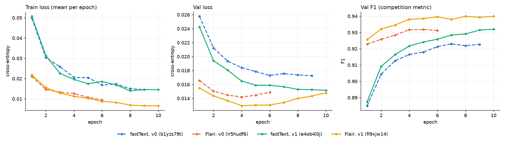
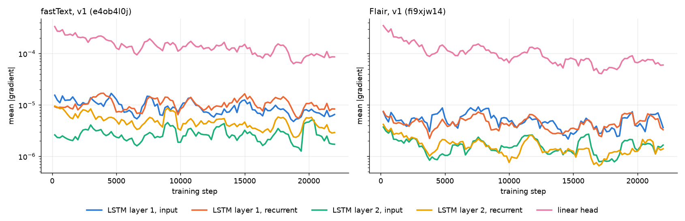

# RNN for Named Entity Recognition

KSE AI301 Deep Learning, Assignment 3: the Kaggle in-class competition
[`kse-ua-location-extraction-2026`](https://www.kaggle.com/competitions/kse-ua-location-extraction-2026).

**The task.**
- The input is a Telegram post, mostly in Ukrainian and sometimes in Russian.
- The output is every location in the post, written exactly as in the text: `Сьогодні з Києва до Хелма вперше вирушив новий поїзд` → `["Києва", "Хелма"]`.
- Locations include cities, countries, regions, districts, streets, addresses and stations.
- The score is micro F1 over the sets of strings.
- Only recurrent models are allowed.

The code uses PyTorch Lightning. Runs, checkpoints, prediction files and dataset versions are tracked in Weights & Biases (project `whoresandbaddies/rnn-for-ner`). The Flair models were trained on a Colab T4.

## Results

We score every model three ways:
- **CV**: our validation set (section 3).
- **Sample**: `labeling_sample.csv`, the only 26 hand-labelled posts that look like test.
- **LB**: the public leaderboard, about half of the 477 test posts.

| Step | Models | Sample F1 | LB |
|---|---|---|---|
| Baseline on 200k given sentences | fastText BiLSTM `xbb5ejtq` | 0.753 | 0.57061 |
| Train rebuilt as test-like posts | fastText BiLSTM `b1yzs79t` | 0.649 | 0.60492 |
| + Viterbi decoding and the test label policy (section 8) | `b1yzs79t` | 0.649 | 0.64367 |
| Averaged probabilities of 4 BiLSTMs | `b1yzs79t`, `lr5hudf6`, `e4ob4l0j`, `fi9xjw14` | 0.800 | 0.64739 |
| + rampart span merging | same 4 | 0.811 | 0.66180 |
| + overlapping 256-word windows, closing-quote fix | same 4 | – | 0.66569 |
| **+ label policy pruned by LB ablation** | same 4 | – | **0.67155** |

Section 6 gives the CV score of every step. Section 3 explains why CV and LB sometimes disagree and why the LB
decided.

On 2026-11-23 the team is **1st on the public LB**. The organisers' reference submission scores 0.64918; last year an
RNN baseline scored 0.562 and BERT 0.648.

Most of the +0.10 over the baseline came from two places, not from the network: training data that looks like test,
and the code that turns word probabilities into answer strings.

## 1. Data

| File | What it is | Rows | Labels |
|---|---|---|---|
| `uk_geo_dataset.csv` | Ukrainian news sentences (Ukr-Synth) | 1.01 M | machine-made spans |
| `ru_geo_dataset.csv` | Russian news sentences (Nerus) | 8.03 M | machine-made spans |
| `labeling_sample.csv` | Telegram posts | 26 | manual, 32 names |
| `test.csv` | Telegram posts | 477 | none |

Train is national news. Test is local Kyiv Telegram (`notebooks/EDA.ipynb`):

| | Train | Test |
|---|---|---|
| Median length | 13 words per uk sentence | 36 words per post |
| Format | single sentences | 85% multi-line, about 60% with emoji, 30% end with a channel signature |
| Texts without a location | 77% of uk sentences | about 35% of posts ¹ |
| Kyiv mentioned | 2% of sentences | 14% of sentences |
| Streets and addresses | 1.6% of labels | 15.6% of sample labels |

¹ Estimated by an automatic regex labeller built from train names (EDA 4.1).

**Vocabulary.** 16% of capitalised test words and 24% of the words in sample answers never occur in uk train, so
pretrained embeddings matter.

**Labelling conventions.** The sources and test also label differently. In test, `поліція Києва` is not a location
and `селі Забуччя` keeps its type word; the train sources often do the opposite. We found these differences with LB
probes, one rule per submission (section 6).

**Duplicates and leakage.**
- 0.37% of uk rows and 6.5% of ru rows are duplicates.
- In 4,786 ru groups the copies disagree on labels.
- No test post appears in any source, in full or in part.

**Adversarial validation** (`notebooks/rnn_adversarial_validation.ipynb`). A BiGRU learns to tell test texts from train
texts; we report out-of-fold ROC AUC.

| Comparison | Given data | Our built data | Text length alone, built data |
|---|---|---|---|
| test vs uk train sentences | 0.870 | 0.848 | 0.67 |
| test vs train posts, no punctuation or digits | – | 0.821 | 0.52 |
| test vs ru | 0.988 | 0.982 | 0.52 |
| val vs train | 0.497 | 0.507 | 0.50 |

Gluing sentences into posts removed the length signal, but topic and vocabulary still separate test from train.
Only 7% of train posts score above the test median, mostly Kyiv city news and streets with house numbers.

### Building the training set (`scripts/build_dataset.py`)

**Stage 1: clean and relabel each sentence.**
- Spans are cleaned: touching spans merged, edges trimmed.
- Duplicates are removed; copies that disagree on labels are dropped.
- The text is normalised 1:1 (`src.tokenizer.prepare`): apostrophes, spaces, emoji and channel footers are replaced
  without changing its length, so span offsets stay valid in the original text.
- Labels are rewritten the way test labels names (`src/label_policy.py`):
  - the street type and house number join the name (`вул. Хрещатик, 22`);
  - so do the settlement type (`селі Забуччя`) and the area type (`Дарницькому районі`);
  - names inside an organisation (`поліція Києва`) and single lowercase words are dropped.

  The same module later post-processes the model output (section 8).

**Stage 2: glue sentences into posts shaped like test.**
- Post lengths and the share of posts without names in each length bin follow test. These targets come from the regex
  labeller, not from hand labels, which the competition forbids.
- Kyiv and street sentences are upsampled ×4 to close the gap in the table above.
- Russian is kept to 20% of train, because test is only 8% Russian and ru is the most distant source.
- Some posts get Telegram layout: a short extra line, a blank line before a signature, a list of bare names, a word in
  capitals.

| W&B artifact | What changed | Train / val posts | Models trained on it |
|---|---|---|---|
| `normalized:v0` | source labels, cleaned; sentences glued into posts | 285,261 / 13,265 | `b1yzs79t`, `lr5hudf6` |
| `normalized:v1` | + labels rewritten like test, lists of bare names | 281,655 / 13,029 | `e4ob4l0j`, `fi9xjw14` |
| `normalized:v3` | + 25% Telegram sentences (UberText-NER-Silver), rare names held out for val | 439,827 / 23,735 | none yet |

In v3, 10% of the rare name stems appear only in val, so `val/f1_unseen` measures names the model never saw.

## 2. Metric

The competition metric (`src/metric.py`, copied verbatim) normalises every string with `hard_processing` and computes
micro F1 over the per-post sets.

Its punctuation regex lacks the `f` of an f-string. It therefore removes only `.`, `(`, `)`, braces and twelve
lowercase Latin letters (`Odesa` → `od`), and keeps the comma, so `Київ,` does not match `Київ`. We trim edge
punctuation from every answer.

There is no lemmatisation, so `Києві` does not match `Київ`. We cut every answer from the original text by its span
offsets.

A one-letter answer normalises to an empty string, which still counts as a false positive. We drop such answers.

A boundary error costs both a false positive and a false negative. A partial answer (`Хрещатик` for `вул. Хрещатик`)
therefore scores worse than no answer at all. This is why labelling conventions weigh so much in this competition.

As an alternative target we propose entity F1 with proper normalisation and partial credit for token overlap. It keeps
the set semantics, but rewards finding a location more than copying the annotator's boundaries. Useful complementary
metrics are precision and recall separately, F1 on names unseen in train, and F1 per language. `src/rnn/train.py` logs
all of them each epoch.

## 3. Validation

**Val** is posts built from held-out sentences. Sentences are assigned by a hash of their normalised text, so
duplicates never cross the split.

**The sample** is the only test-like check. It has just 32 names, and one post holds 10 of them, so differences below
about 0.05 are noise.

Val and the LB disagree:

| Model (train data) | v1 val F1 | Sample F1 | LB, raw | LB, with label policy |
|---|---|---|---|---|
| fastText `b1yzs79t` (v0) | 0.8949 | 0.649 | 0.61403 | **0.64367** |
| Flair `lr5hudf6` (v0) | 0.9038 | 0.667 | 0.62299 | 0.64194 ² |
| fastText `e4ob4l0j` (v1) | 0.9330 | 0.750 | 0.63068 | 0.63519 |
| Flair `fi9xjw14` (v1) | **0.9401** | **0.795** | 0.61904 | 0.61624 ² |

² Without the bracket and lowercase-word rules of the policy (+0.004 for each fastText model).

v1 rewrote the labels of train *and* val with our guesses about test, so v1 models agree with v1 val and gain up to
0.04 there. The sample favours them too, because the same guesses were partly read off those 26 posts. On the LB,
once the policy is applied to every model's output, they are no better.

Adversarial validation agrees: it cannot tell val from train (0.507), and val is as far from test as train is (0.810
vs 0.821).

So val only shows that a model learns and picks the epoch. Choices that depend on how test is labelled (label policy,
decoding, ensembling) were made on the LB, one change per submission. Each such delta is 1–3 public posts, so the
private half may disagree.

## 4. Tokenization and embeddings

**Tokenizer** (`src/tokenizer.py`). A regex word tokenizer runs on the normalised text; line breaks are tokens and
emoji are split off words. Converting gold spans to BIO tags and back keeps 99.5% of them (oracle F1 0.996 on uk
train). IO tags would give only 0.979, because they merge adjacent names.

**Word-level vs BPE.** The same BiLSTM was trained on 200k given sentences for 5 epochs.

| Run | Tokens and embeddings | Val F1 | Sample F1 | LB |
|---|---|---|---|---|
| `jv9r39lu` | BPE pieces, BPEmb uk (50k vocabulary) | 0.8564 | 0.613 | 0.56186 |
| `xbb5ejtq` | words, fastText `cc.uk.300` | **0.8751** | **0.753** | **0.57061** |

Words won on every score. BPE was later removed from the code (`docs/historic/bpe-tokenization.md`).

**Embeddings.** Both kinds are frozen.
- **fastText `cc.uk.300`.** One row per word of our data that fastText knows, plus train words seen at least twice
  (~471k rows). The lookup also tries the lowercase form and other apostrophe spellings.
- **Flair**: forward and backward Ukrainian character language models (`dchaplinsky/flair-uk-*`), 2,048 values per
  word. A character model builds a vector for any word form, which helps with case endings (`Києві`, `Києва`) and
  with names missing from fastText.

## 5. Models

The four ensemble members share one architecture, with the usual BiLSTM-NER settings; we did not tune them:

```
frozen fastText (300) or Flair (2048) → dropout 0.3 → BiLSTM, 2 layers × 256 per direction, dropout 0.3
→ linear layer → O / B / I, cross-entropy
```

- Optimiser: AdamW, lr 1e-3, weight decay 1e-2, no scheduler, gradient clipping 1.0.
- Batches: 128 posts, bucketed by length.
- Stopping: at most 10 epochs; stop after 2 epochs without a val F1 gain, keeping the best epoch.
- Size: 2.7 M trainable parameters with fastText, 6.3 M with Flair.

**The code on `main` has a newer model.**
- Inputs: fastText + Flair + a character CNN + a word-shape embedding, with word dropout.
- Output: a linear-chain CRF (`src/rnn/crf.py`). Its marginals feed the same decoding and ensemble code.
- Training: the learning rate halves after an epoch without a val gain.
- Every setting is a flag: `--model.rnn gru --model.num_layers 1 --model.bidirectional false --optim.scheduler cosine
  --vocab.freeze_embeddings false`.

This model has not been trained yet (section 10).

## 6. Experiments: CV and LB

¹ marks a val set older than `normalized:v1`. "Policy" is the label policy of section 8. ² The two Flair
submissions lack the bracket and lowercase-word rules of the policy (worth +0.004 for each fastText model).

| Date | Experiment | Val F1 | Sample F1 | LB |
|---|---|---|---|---|
| 11-10 | fastText BiLSTM, 200k given sentences (`xbb5ejtq`) | 0.8751 ¹ | 0.753 | 0.57061 |
| 11-10 | BPEmb BiLSTM, same (`jv9r39lu`) | 0.8564 ¹ | 0.613 | 0.56186 |
| 11-11 | Flair BiLSTM, 200k sentences, batch 32 (`be5zjzr5`) | 0.8885 ¹ | 0.700 | 0.59740 |
| 11-12 | Flair BiLSTM, all 1M sentences, batch 128 (`rj3r0ztu`) | 0.9016 ¹ | 0.709 | 0.58285 |
| 11-12 | fastText BiLSTM on built posts, v0 (`b1yzs79t`) | 0.9230 ¹ | 0.649 | 0.60492 |
| 11-12 | the same without `Україна` in answers | – | – | 0.59021 |
| 11-12 | + 10% synthetic address sentences (`y6r6funv`) | 0.9259 ¹ | 0.709 | 0.59411 |
| 11-13 | Flair BiLSTM on v0 (`lr5hudf6`) | 0.9318 ¹ | 0.667 | 0.61248 |
| 11-15 | `b1yzs79t`, Viterbi + policy | 0.8949 | 0.649 | 0.64367 |
| 11-15 | `lr5hudf6`, Viterbi + policy ² | 0.9038 | 0.667 | 0.64194 |
| 11-15 | fastText on v1 (`e4ob4l0j`), Viterbi + policy | 0.9330 | 0.750 | 0.63519 |
| 11-15 | Flair on v1 (`fi9xjw14`), Viterbi + policy ² | 0.9401 | 0.795 | 0.61624 |
| 11-15 | ensemble of the 4 | 0.9271 | 0.800 | 0.64739 |
| 11-19 | + O-class weight 0.9 | 0.9277 | 0.769 | 0.64663 |
| 11-19 | + rampart merging | 0.9090 | 0.811 | 0.66180 |
| 11-19 | + windows of 128 words, overlap 64 | – | – | 0.66084 |
| 11-19 | + windows of 256 words, overlap 64 | – | – | 0.66277 |
| 11-20 | + closing-quote fix | – | – | 0.66569 |
| 11-22 | + policy ablation | – | – | **0.67155** |

**What the comparisons show.**
- The 1M-sentence Flair run was worse on the LB than the 200k one; size and batch changed together, and both runs
  predate the built posts.
- `Україна` is labelled in about half of its test mentions. Removing it loses more true positives than false ones.
- Synthetic addresses helped on val but hurt on the LB.
- The windows (11-19) were added while train posts had at most 352 tokens and test posts up to 605. Train now has
  posts of up to 615 tokens, so `main` reads posts whole.

The policy rules themselves came from 14 earlier probe submissions (11-12, 11-13), each testing one rule.

## 7. Training curves and gradient flow

Both figures are drawn by `python -m scripts.figures` from the W&B histories.



Each data version has its own val set, so compare curves within a version.
- **Flair** starts at 0.923–0.926 val F1 after one epoch, about where fastText ends after ten.
- **Flair's val loss rises after epoch 4** while val F1 stays flat. The model becomes overconfident on the words it
  gets wrong, without getting more of them wrong. Early stopping on F1 keeps the best epoch.
- **fastText on v1** is still improving at epoch 10.



The figure shows the mean absolute gradient of each weight matrix, from the gradient histograms W&B logged every 200
steps. The first LSTM layer, farther from the loss, gets gradients as large as the second or larger, so they do not
vanish with depth. No curve spikes, so they do not explode either.

## 8. Post-processing

`src/decoding.py` and `src/submission.py` turn word probabilities into answers in five steps:

1. **Viterbi** finds the best tag path with O→I and start→I forbidden. Argmax could start a name on I
   (`Михайлівського` + `собору`).
2. **Rampart merging**, ported from `classifier.ts` of the rampart project (CC BY 4.0).
   - A span's score is the mean probability of its words' tags.
   - Spans scoring at least 0.4 are kept.
   - Weaker spans (at least 0.15) are kept only when a space, hyphen, apostrophe or an initial's period joins them to
     a kept span.
3. **Span repairs.** Spans are split at line breaks, and edge punctuation is trimmed, except a quote the name opens
   (`метро «Лісова»`).
4. **The label policy** rewrites the spans the same way stage 1 rewrites train labels. "Raw" in the tables means
   without it.
5. **Answers are cut** from the original text, without duplicates.

**Threshold optimisation.** We multiply P(O) by a weight before decoding: below 1 the model finds more names, above 1
fewer. Grid on val:

| O weight | 0.5 | 0.8 | **0.9** | 1.0 | 1.1 | 1.4 | 2.0 |
|---|---|---|---|---|---|---|---|
| Val F1 | 0.9226 | 0.9270 | **0.9277** | 0.9271 | 0.9218 | 0.9207 | 0.9164 |
| Sample F1 | 0.756 | 0.775 | 0.769 | 0.800 | 0.811 | 0.761 | 0.735 |
| LB | | | 0.64663 | 0.64739 | | | |

The best val weight lost on the LB, so we dropped the weight. Rampart's 0.4 / 0.15 are now the only thresholds.

**Entity merging.**

| Decoder | Val F1 | Sample F1 | LB |
|---|---|---|---|
| argmax | 0.9253 | 0.800 | |
| argmax, then BIO repair | 0.9270 | 0.800 | |
| **Viterbi** | **0.9271** | 0.800 | 0.64739 |
| Viterbi, then adjacent spans merged | 0.9200 | 0.800 | |
| rampart on argmax tags | 0.9055 | 0.779 | |
| **rampart on Viterbi tags** | 0.9090 | **0.811** | **0.66180** |

Rampart lost 0.018 on val and gained 0.014 on the LB, the largest disagreement in the project. Val posts are glued from
whole sentences with clean boundaries. Telegram text likely breaks names with odd spacing, hyphens and apostrophes,
which is what rampart joins.

**Label policy, one step left out at a time** (11-22, the ensemble above):

| Variant | Test posts changed | LB |
|---|---|---|
| full policy of that day | – | 0.66473 |
| without labelling «столиця» as a location | 10 | 0.66959 |
| without labelling facilities (parks, stations, airports) | 3 | 0.66666 |
| without joining house numbers | 2 | 0.66473 |
| without dropping names inside organisations | 7 | 0.66184 |
| without joining settlement types | 9 | 0.66182 |
| no policy | 28 | 0.66569 |
| **without the first three** | 15 | **0.67155** |

## 9. Ensemble

`src/ensemble.py` averages the per-word probabilities of the members and decodes once. This is averaging, not
stacking. All members share the tokenizer, so their rows align word for word. The weights are equal: val favours the
v1 members (section 3), so it could not be used to fit them.

| Members | Val F1 | Sample F1 | LB |
|---|---|---|---|
| fastText v0 alone | 0.8949 | 0.649 | 0.64367 |
| fastText v0 + Flair v0 | 0.9047 | 0.658 | |
| fastText v0 + fastText v1 | 0.9190 | 0.769 | |
| fastText v1 + Flair v1 | 0.9428 | 0.827 | |
| **all 4** | 0.9271 | 0.800 | **0.64739** |

The four-model ensemble beats the best single model on the LB by 0.004.

## 10. Conclusions

**Is the model adequate?** A BiLSTM reaches 0.93–0.94 F1 on held-out news posts. An ensemble of four is 1st on the
public LB and beats the organisers' reference and last year's BERT.

**What made the difference, roughly in order of gain:**

| Change | LB gain |
|---|---|
| Train rebuilt as test-like posts, all data instead of 200k sentences (one fastText model) | 0.571 → 0.605 |
| Post-processing for that model | 0.605 → 0.644 |
| Ensemble post-processing (rampart, pruned label policy) | 0.647 → 0.672 |
| Ensembling | +0.004 |

Among the modelling choices, words beat BPE, and Flair beat fastText on val and matched it on the LB.

**What did not work:** BPE, synthetic addresses, dropping `Україна`, an O threshold tuned on val, labelling «столиця»
and facilities, and 128-word windows.

The gap between val (0.93) and the LB (0.67) is mostly labelling conventions and domain, not model capacity. A val set
relabelled with our own guesses about test ranked the models in reverse order of the LB.

**Not done yet:**
- **Recurrent architecture comparisons.** GRU vs LSTM, depth, one vs two directions, schedulers and unfrozen
  embeddings are all flags in the code, but have no recorded runs.
- **The model on `main`.** The CRF + character-CNN model has not been trained on `normalized:v3`.
- **Reproducing 0.67155.** The probability files in `ensemble-probs` predate a tokenizer change, so `src.ensemble` on
  `main` rejects them. They must be re-aligned and uploaded again.

## Reproduce

```bash
uv sync --extra flair
cp .env.example .env    # WANDB_API_KEY, KAGGLE_API_TOKEN
uv run --env-file .env kaggle competitions download -c kse-ua-location-extraction-2026 -p data
unzip data/kse-ua-location-extraction-2026.zip -d data

uv run python -m scripts.fetch_ubertext            # Telegram sentences → data/tg_geo_dataset.csv
uv run python -m scripts.build_dataset --upload    # data/normalized/, logged to W&B as `normalized`

uv run --env-file .env python -m src.rnn.train --vocab.embedding fasttext
uv run python -m src.rnn.predict models/<run>/best.ckpt --out models/<run>/probs.npz
uv run python -m src.ensemble models/<a>/probs.npz models/<b>/probs.npz --name ens    # submission/ens.csv
uv run python -m scripts.compare_decoders models/<a>/probs.npz ...                   # post-processing ablations
uv run --group eda --env-file .env python -m scripts.figures                        # docs/figures/
```

On Colab, `notebooks/rnn_train.ipynb` clones `main`, downloads the data and the latest `normalized` artifact, and runs
one experiment per cell.

Each run logs its best checkpoint (`model-<run id>`) to W&B, together with its submission files and `probs.npz`
(`submission-<run id>`). The four ensemble members were trained before the CRF model, so their checkpoints load only
at the commits they were trained on: `1da6a94`, `02b9df9` and `49ad446`.

## Structure

```
data/                    competition files, embeddings, normalized/ (not in git)
docs/figures/            training curves, gradient flow
docs/historic/           BPE vs words; threshold, merging and policy ablations
notebooks/               EDA, adversarial validation (rnn_, transformer_), Colab RNN training
scripts/
├── build_dataset.py     sources → test-like posts → train/val
├── fetch_ubertext.py    Telegram sentences (UberText-NER-Silver)
├── compare_decoders.py  post-processing ablations
└── figures.py           report figures from W&B
src/
├── config.py            paths
├── tokenizer.py         1:1 normalisation, word tokens
├── tags.py              O/B/I, spans ↔ tags
├── dataset.py           files → tokenized, tagged posts
├── decoding.py          Viterbi, rampart, span repairs
├── label_policy.py      how test labels names
├── submission.py        probabilities → answers → csv
├── ensemble.py          probs.npz, probability averaging
├── metric.py            competition metric
├── colab.py             Colab setup
└── rnn/
    ├── config.py        run config, CLI flags
    ├── vocab.py         fastText vocabulary, characters, word shape
    ├── dataset.py       posts → examples → length-bucketed batches
    ├── model.py         embedders, BiLSTM/BiGRU, training module
    ├── crf.py           linear-chain CRF
    ├── train.py         training, per-epoch val/sample scores, export
    └── predict.py       checkpoint → probs.npz
```
