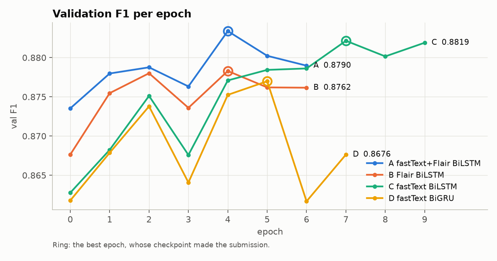
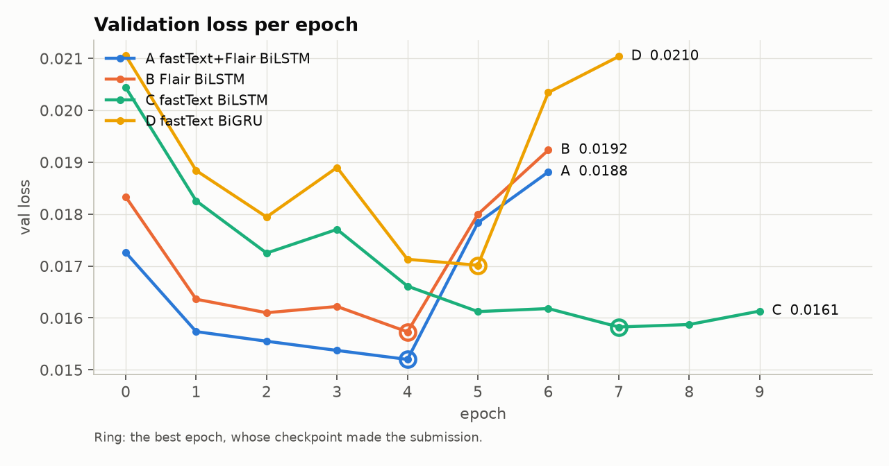
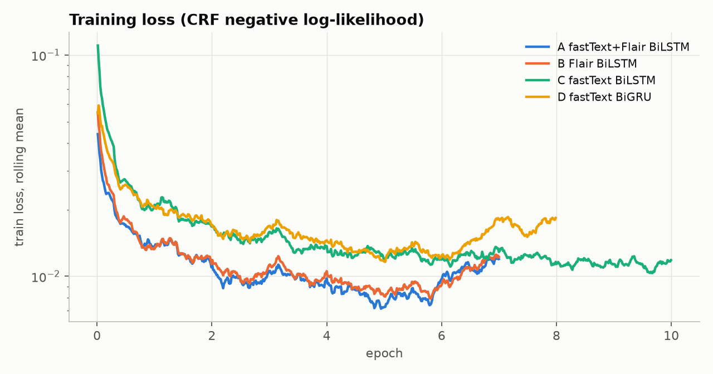
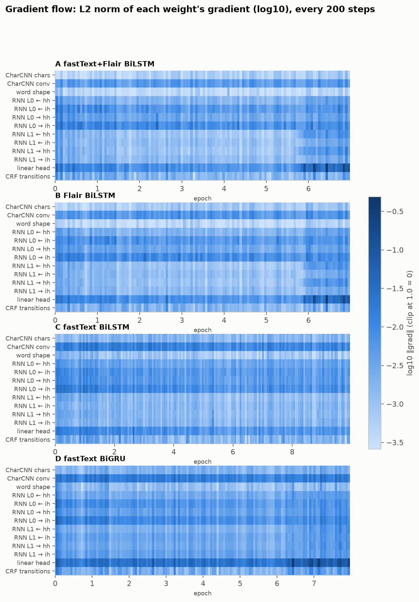
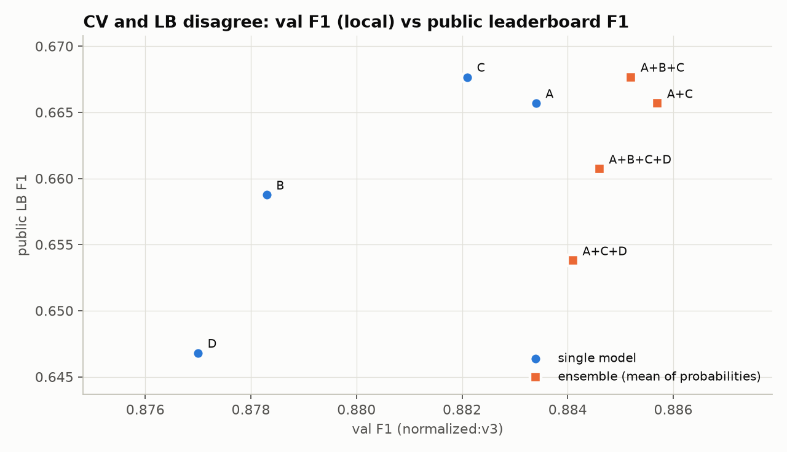

# Results of the v3 runs (2026-11-23)

Material for the report: the four models retrained on the current code and data, their ensembles, and a check of
the post-processing. Figures and CSV come from W&B through `scripts/report_figures.py`. Ensemble LB scores come from
Kaggle and are written by hand in `leaderboard.csv`.

## Setup

- **Data:** `normalized:v3` (W&B artifact), rebuilt with `scripts.build_dataset` after the label-policy change of
  `2bfa9fc`: 439,827 train posts, 23,735 val posts. Val keeps held-out names (27.4% of its names are not labelled in
  train; test: 23-28%).
- **Model:** word vectors (fastText and/or Flair, frozen) + CharCNN + word shape → 2-layer bidirectional RNN
  (hidden 256) → linear head → CRF. AdamW, LR 1e-3, weight decay 1e-2, grad clip 1.0, batch 128,
  ReduceLROnPlateau (×0.5 after an epoch without val gain), early stopping with patience 2, at most 10 epochs.
  Only the embeddings and the RNN type differ between runs.
- **Submission path:** Viterbi (no span starts on I) → rampart entity merging → span repairs → test label policy.
- **CV:** F1 on val. **LB:** public leaderboard F1.

## Single models

| Model | W&B run | Epochs (best) | val P | val R | **val F1** | F1 seen | F1 unseen | F1 uk | F1 ru | F1 tg | sample F1 | **LB** |
|---|---|---|---|---|---|---|---|---|---|---|---|---|
| A fastText+Flair BiLSTM | `wzoh8guc` | 7 (4) | 0.9093 | 0.8589 | **0.8834** | 0.9234 | 0.7672 | 0.8709 | 0.9478 | 0.8915 | 0.8267 | 0.66568 |
| B Flair BiLSTM | `nfece7iu` | 7 (4) | 0.9099 | 0.8488 | 0.8783 | 0.9198 | 0.7581 | 0.8639 | 0.9464 | 0.8883 | 0.8219 | 0.65875 |
| C fastText BiLSTM | `3yd46rm3` | 10 (7) | 0.9128 | 0.8535 | 0.8821 | 0.9236 | 0.7613 | 0.8710 | 0.9447 | 0.8889 | 0.8378 | **0.66766** |
| D fastText BiGRU | `pbue6w0u` | 8 (5) | 0.9069 | 0.8490 | 0.8770 | 0.9195 | 0.7531 | 0.8619 | 0.9400 | 0.8884 | 0.8158 | 0.64679 |

Metrics are taken at the best epoch, whose checkpoint made the submission. *Seen/unseen* split val names by whether
train labels them. *uk/ru/tg* are the val sources. Full per-epoch history is in `epochs.csv`, one row per run in
`runs.csv`. Use the finished W&B runs above: the project also holds crashed attempts with the same names
(`kt9ggwy5`, `xuxn33m4`, `kar1yg8l`, `nod4hjm9`), interrupted by Colab disconnects or stopped when a run moved to
another machine.

## Ensembles

Weighted mean of the members' word probabilities (equal weights), then the same submission path
(`python -m src.ensemble <probs.npz> ... --name <name>`).

| Ensemble | val P | val R | **val F1** | LB |
|---|---|---|---|---|
| A+C | 0.9139 | 0.8592 | **0.8857** | 0.66567 |
| A+B+C | 0.9144 | 0.8578 | 0.8852 | **0.66766** |
| A+B+C+D | 0.9145 | 0.8566 | 0.8846 | 0.66071 |
| A+C+D | 0.9131 | 0.8568 | 0.8841 | 0.65378 |

The best LB of the project is still **0.67155**: the 2026-11-22 ensemble of four older models with the current
label policy.

## Post-processing check on the new models

`scripts/compare_decoders` on A+B+C. Earlier experiments (O-class threshold, decoders, rampart thresholds,
label-policy ablation) are in `docs/historic/postprocessing.md`.

| Decoding | val F1 | LB | test posts changed |
|---|---|---|---|
| rampart (submission path) | 0.8852 | **0.66766** | — |
| Viterbi without rampart | **0.9206** | 0.66172 | 6 |
| without `split_at_newlines` / `trim_edges` | 0.8851 | — | 1 / 0 |
| without any single label-policy step | — | — | 0-1 |

## Observations

1. **Flair helps CV but not LB.** fastText+Flair (A) has the best val F1 of the single models, yet fastText alone (C)
   scores higher on LB. Flair alone (B) is below C on both.
2. **LSTM beats GRU.** With the same fastText input, D (GRU) is below C (LSTM) on val (−0.005) and on LB (−0.021).
   D is also the least stable run: val F1 falls 0.016 at epoch 6 (`val_f1.png`).
3. **Ensembles help CV, not LB.** Every ensemble beats every single model on val. On LB none beats C, and every
   ensemble with D loses.
4. **CV and LB disagree on decoding as well.** Dropping rampart adds +0.035 val F1, a significant gain by paired
   bootstrap, but loses 0.006 on LB. The same happened before (`docs/historic/postprocessing.md`, section 2):
   rampart joins name pieces across a space, hyphen or apostrophe, which pays off on test's Telegram posts.
5. **The gap between CV (~0.88) and LB (~0.66) is the largest open issue.** Unseen names alone do not explain it:
   val F1 on unseen names is still ~0.76. The differences between our LB scores are 1-3 test posts of the public
   half, so ranks within ~0.01 may not hold on the private half.
6. **All four models dip at epoch 3.** They share the seed, and so the batch order, so the dip is likely a
   property of the data order rather than of any model. ReduceLROnPlateau then halves the LR (1e-3 → 5e-4) for all.
7. **No vanishing or exploding gradients** (`gradient_flow.png`). Per-weight gradient norms stay between ~3e-4
   and ~0.4, below the clip of 1.0. The first RNN layer gets larger gradients than the second, and the norms do not fade with
   depth. The head's gradient grows in the last epochs of A, B and D, when train loss rises too (`train_loss.png`).
   That is where early stopping ends these runs.

## Figures

| File | Shows |
|---|---|
| `val_f1.png` | val F1 per epoch; a ring marks the best epoch |
| `val_loss.png` | val loss per epoch |
| `train_loss.png` | train loss (CRF NLL) against epochs, rolling mean, log scale |
| `gradient_flow.png` | gradient norm of every weight over training, one heatmap per model |
| `cv_vs_lb.png` | val F1 against LB for the models and the ensembles |







## Reproduce

```bash
uv run python -m scripts.build_dataset --upload                 # normalized:v3
python -m src.train --vocab.embedding fasttext+flair            # A; B: flair; C: fasttext; D: fasttext --model.rnn gru
python -m src.ensemble <run>/probs.npz ... --name <name>        # probs.npz: W&B artifact submission-<run id>
uv run --group eda python -m scripts.report_figures            # this folder
```

Training time: A and B ~1.5 h on an L4 (Flair is the slow part), C ~1 h on an L4, D ~1 h on a T4.
